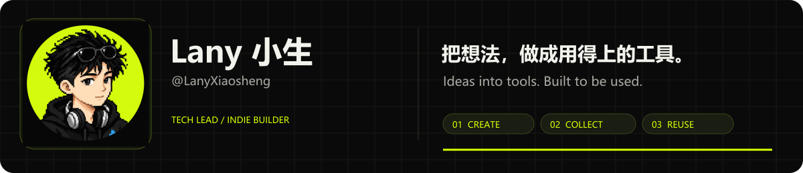
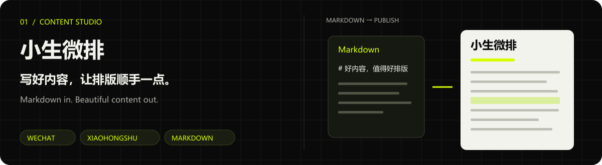
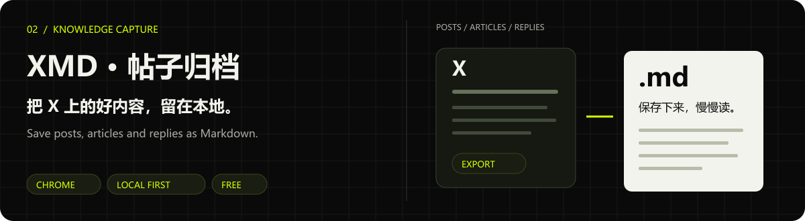
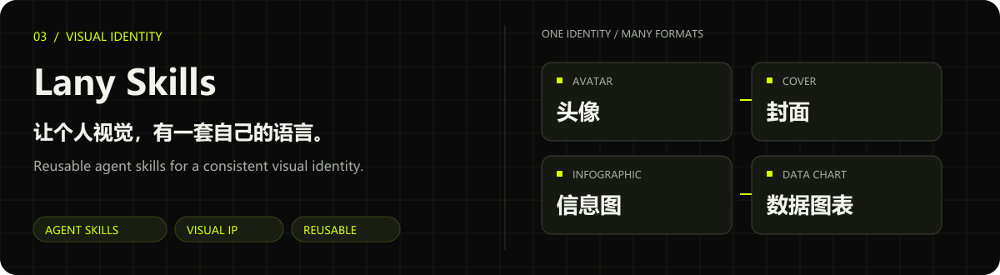
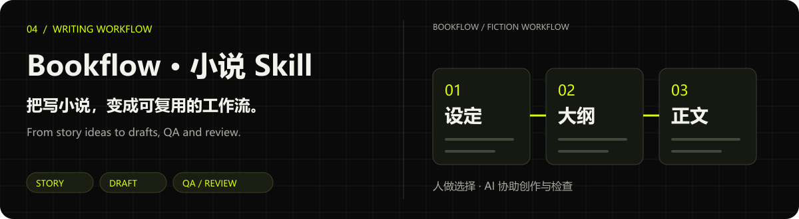
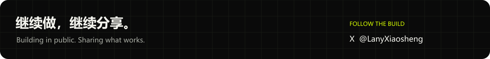

**白天技术 Leader，晚上独立开发。小生微排作者，Punk 铁粉。用 AI 做产品，也倒腾副业，分享代码、工具、收益和踩坑。** 
Tech lead by day, indie builder by night. Creator of Xiaosheng Weipai and a fan of Punk. I build with AI and share the code, tools, wins, and lessons along the way.

## ✍️ 小生微排 · Xiaosheng Weipai

**一个让内容创作者少折腾排版的 Markdown 工作台。** 从原稿到预览，调整配色与个人 IP，生成公众号富文本和小红书卡片，把时间留给内容本身。 
**A Markdown workspace that takes the friction out of content formatting.** Preview your draft, tune the colors and visual identity, and turn it into WeChat rich text or Xiaohongshu cards.

[**↗ 在线体验 / Try it**](https://app.lanyxiaosheng.com)

## 📥 XMD · 帖子归档

**把 X 帖子、长文和评论保存为本地 Markdown。** 支持单帖与批量导出，保留长文结构和图片链接；无需 X API Key，内容在浏览器本地处理，导出功能免费。 
**Save X posts, articles, and replies as local Markdown.** Export one post or a batch, keeping article structure and image links. Free exports, local processing, and no X API key required.

[**↗ 查看项目与安装 / Get XMD**](https://github.com/LanyXiaosheng/x-post-markdown) · [使用说明 / Guide](https://github.com/LanyXiaosheng/x-post-markdown#readme)

## ⚡ Lany Skills · 个人视觉工具箱

**把个人视觉沉淀成能反复调用的 Agent Skills。** 覆盖头像、Banner、封面、正文插图、信息图、真实数据图表和中文标题字形。仓库整理了 Lany 与 Punk 两套视觉技能，具体来源见各技能说明。 
**Reusable agent skills for a consistent visual identity.** From avatars, banners, and covers to article illustrations, infographics, data charts, and Chinese typography. Includes Lany and Punk collections; see each skill for its source and credits.

[**↗ 浏览技能 / Explore skills**](https://github.com/LanyXiaosheng/lany-skills) · [视觉体系 / Visual system](https://github.com/LanyXiaosheng/lany-skills/blob/master/VISUAL-IP-SYSTEM.md)

## 📚 Bookflow · AI 小说 Skill

**把 AI 辅助写小说整理成可复用的流程。** 从选题、人物和大纲，到正文、QA 与复盘，人负责方向与选择，AI 协助结构化、草稿和检查。 
**A reusable AI-assisted fiction workflow.** From ideation, characters, and outlining to drafting, QA, and review. You make the creative decisions; AI helps organize, draft, and check.

[**↗ 查看 Skill / Explore the skill**](https://github.com/LanyXiaosheng/bookflow-skill) · [跨平台适配 / HTTP & SSE integration](https://github.com/LanyXiaosheng/bookflow-agent-skill)

如果这些项目对你有用，欢迎留下一颗 ⭐，也欢迎带着真实使用反馈来找我。 
If something here helps, a star or a note about how you use it means a lot.
